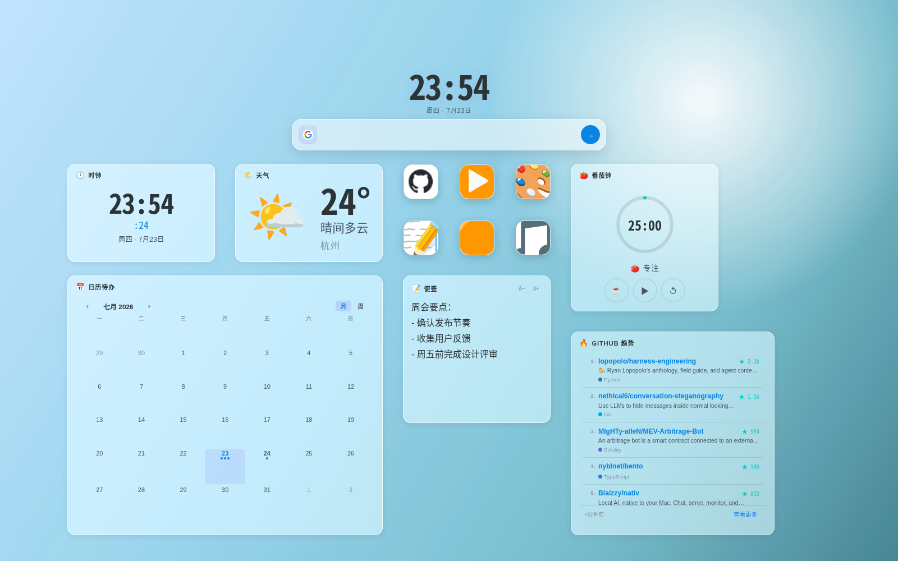
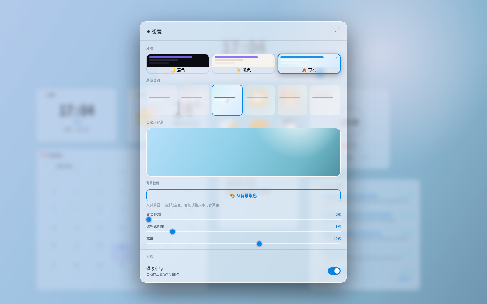
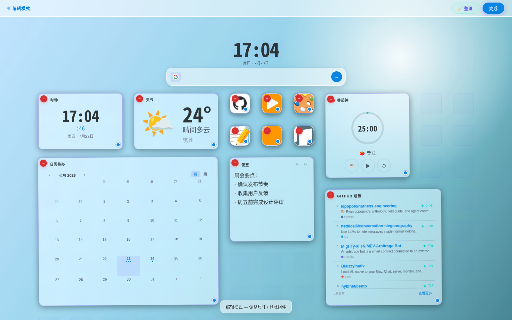
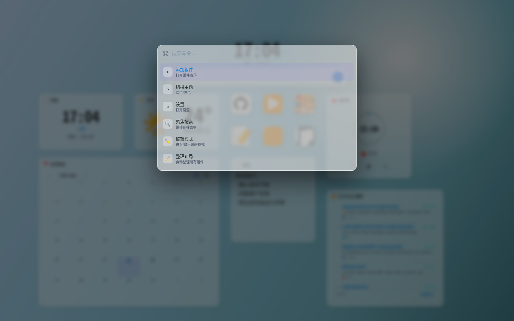

# Zen Tab

一个简洁、可高度自定义的浏览器新标签页仪表盘。纯原生 JS + CSS 实现，运行时仅使用 GridStack（vendored），使用 esbuild 打包压缩，以 Chrome 扩展（Manifest V3）形式运行。



---

## 功能特性

### 🧩 组件系统

自由组合以下 8 种组件，拖拽调整顺序、随时增删：

| 组件 | 说明 |
|---|---|
| 🕐 时钟 | 实时时间与日期，随组件尺寸自动缩放字号 |
| 🔗 快捷链接 | 独立的图标式链接，支持自动抓取网站图标、Emoji 或自定义上传图片 |
| 📝 便签 | 本地文本便签，字号可调，自动保存 |
| 📅 日历待办 | 月视图 / 周视图切换，按日期管理任务，支持拖拽调整任务日期 |
| 🌤 天气 | 基于 Open-Meteo 的实时天气，自动定位城市，点击展开 7 天预报 |
| 🍅 番茄钟 | 专注计时器，时长可自定义，专注 / 休息模式一键切换 |
| 🔥 GitHub 趋势 | 每日热门仓库榜单，含语言、星标数，支持展开更多 |
| 🌐 网页嵌入 | 在 iframe 中嵌入任意网页 |

组件面板（`Ctrl+A`）里可以按分类筛选、搜索添加；每个组件右上角悬浮显示专属操作（比如便签的字号调节）；链接编辑与删除通过右键菜单，编辑模式左上角也提供删除按钮。

### 🎨 主题与个性化

- **三套主题**：深色 / 浅色 / 莫奈（莫奈主题含薰衣草、玫瑰、海洋、丛林、陶土、沙丘 6 种色调）
- 主题切换使用 View Transition 圆形揭示：新主题快照从点击位置扩散、取代旧主题；1200ms 先慢后快
- **自定义背景**：上传任意图片作为背景，支持模糊、遮罩透明度、亮度调节
- **背景取色**：一键从背景图提取主色调（Canvas + K-means 聚类），自动生成匹配的强调色、文字色与卡片配色，让界面跟着背景图走

<p align="center"></p>

### 🖱 布局与交互

- **GridStack 网格布局**：拖拽/缩放按网格吸附，`compact()` 填满空隙；每个可见列数缓存独立布局，窗口缩小再恢复会回到同一位置
- **普通模式即可拖拽**：从标题/空白区域拖动，6px 阈值；输入框、按钮、链接、任务项不触发拖拽
- **编辑模式缩放/删除**：右下角缩放手柄、左上角删除按钮只在编辑模式出现；图标类组件保持宽高比；编辑模式会关闭组件内部交互（链接、输入框、iframe、按钮），只保留拖拽/缩放/删除
- **重叠保护**：加载、缩放或拖拽后检测网格节点是否相交；只有发现重叠才自动 `compact()` 整理，避免刷新后叠在一起
- **批量快捷链接**：设置面板中每行填写「名称,https://example.com」或直接 URL，一次添加多个链接
- 每个组件左上角一个删除按钮（编辑模式，二次确认，防误删）
- 图标类组件（链接/番茄钟/天气/时钟）保持固定宽高比，不会被拉变形
- 长按空白区域或组件约 0.2s 后才显示进度环并进入编辑模式；普通点击不会出现圆圈
- 右键组件：编辑、复制链接、移到最前、删除
- 纯净模式：隐藏所有组件，只保留时钟与搜索框，专注当下

<p align="center"></p>

### ⌨️ 命令面板与快捷键

`Ctrl+K` 呼出命令面板，模糊搜索所有操作——添加组件、切换主题、进入编辑模式……不用鼠标也能掌控整个仪表盘。

<p align="center"></p>

### 🔍 搜索与语言

- 搜索框支持 Google / Bing / DuckDuckGo / 百度，`Tab` 键快速轮换引擎
- 中文 / English 双语界面，实时切换，无需刷新

---

## 快捷键

| 快捷键 | 功能 |
|---|---|
| `Ctrl+K` | 打开命令面板 |
| `Ctrl+A` | 打开组件库 |
| `Ctrl+M` | 切换主题 |
| `Ctrl+E` | 进入 / 退出编辑模式 |
| `Ctrl+P` | 进入 / 退出纯净模式 |
| `/` | 聚焦搜索框 |
| `Esc` | 关闭当前面板 / 退出模式 |
| `Tab`（搜索框内） | 切换搜索引擎 |

---

## 安装方式

### 开发者模式安装（推荐）

1. 克隆或下载本仓库
   ```bash
   git clone https://github.com/Coveduoji/zen-tab.git
   cd zen-tab
   ```
2. 安装依赖并构建（仓库已包含 `dist/` 产物，可直接跳到第 3 步；修改源码后需要重新构建）
   ```bash
   npm install
   npm run build      # 开发时可用 npm run watch
   ```
3. 打开 Chrome，地址栏访问 `chrome://extensions`
4. 右上角开启 **开发者模式**
5. 点击 **加载已解压的扩展程序**，选择**仓库根目录**（`manifest.json` 所在目录，不是 `dist/`）
6. 打开新标签页即可使用

> **不要**把 `dist/` 作为扩展根目录加载：Chrome 为未打包扩展生成的 ID 取决于扩展根路径，换目录会变成新的扩展 ID，原有 localStorage 数据将不可见。`manifest.json` 始终在仓库根目录，只把 newtab 页面和图标指向 `dist/`。

> 首帧主题脚本是独立的 `js/theme-init.js`：MV3 不允许内联脚本，`manifest.json` 里的 CSP 哈希也会被扩展加载器判为 `Insecure CSP value`，因此只能使用本地外部脚本。它很小，且不读取多 MB 的背景数据。

---

## 项目结构

```
zen-tab/
├── manifest.json          # Chrome 扩展清单（Manifest V3，扩展根目录）
├── newtab.html             # 源码：页面模板（构建时生成 dist/newtab.html）
├── style.css                # 源码：全局样式（构建时压缩到 dist/style.css）
├── icons/                    # 构建用图标（16/32/48/128，由 assets/ 源图生成）
├── assets/icon-source.png   # 2048px 原始图标（不随扩展加载）
├── dist/                     # 构建产物：newtab.html + style.css + js/app.js + icons/ + vendor/
├── scripts/                  # build / icons / smoke / perf 脚本
├── tests/                    # node:test 单元测试
├── screenshots/          # README 截图
│
└── js/
    ├── registry.js        # 组件注册表与目录（REG / CATALOG）
    ├── i18n.js             # 国际化（中 / 英双语）
    ├── utils.js            # 工具函数（esc / normalizeUrl / genId / 图片压缩等）
    ├── core/ticker.js      # 全页共享的整秒 ticker（替代每个时钟各自 setInterval）
    ├── layout.js           # 网格尺寸规则 / readGeom / 宽高比与尺寸限制
    ├── state.js            # 状态管理（loadState / 增量 saveState）
    ├── theme.js            # 主题系统（切换动画 / 幂等背景 / 调色板提取）
    ├── theme-init.js       # 首帧主题提示（style.css 之前加载，避免主题闪烁）
    ├── main.js              # 入口，串联初始化流程
    │
    ├── ui/
    │   ├── toast.js         # 通知与确认弹窗
    │   ├── search.js       # 搜索引擎切换器
    │   ├── editmode.js   # 编辑模式与网格背景
    │   ├── render.js       # 组件渲染 + GridStack 集成（拖拽 / 缩放 / 按列布局缓存）
    │   ├── linkmodal.js  # 链接编辑弹窗
    │   ├── cmdpalette.js # 命令面板
    │   ├── puremode.js   # 纯净模式
    │   ├── settings.js    # 设置面板与组件库
    │   └── panels.js       # FAB / 右键菜单 / 快捷键 / 顶部时钟
    │
    └── widgets/
        ├── clock.js
        ├── link.js
        ├── notes.js
        ├── todo.js
        ├── weather.js
        ├── pomodoro.js
        ├── embed.js
        └── gtrend.js
```

---

## 数据存储

所有数据存储在浏览器 `localStorage` 中：

| Key | 内容 |
|---|---|
| `dash_v3` | 主状态（组件顺序/尺寸 + 设置），大图片替换为占位符；`orderOnly: true` 为兼容标记 |
| `dash_bg_img` | 背景图片 base64（单独存储，原图质量不压缩） |
| `dash_limg_<id>` | 链接组件自定义图标 base64（上传时自动压缩到 400px 以内） |
| `gridLayouts` | 各可见列数（GridStack column）对应的布局：组件 id → x/y/w/h |
| `dash_theme` | 首帧主题提示（theme / hue），几十字节，可由 `dash_v3` 重建 |
| `cal_tasks_v1` | 日历待办的任务数据，跨所有日历组件实例共享 |
| `weather_cache_v2` / `gtrend_cache_v2` | 天气 / GitHub 趋势的接口响应缓存（10 分钟过期） |
| `weather_city_v1` | 城市反查结果缓存（7 天，按约 0.01° 经纬度） |

存储版本号为 `3`，数据结构变更时会自动迁移而不丢失用户数据；容量超限时会给出提示并做降级保存，不会导致数据完全丢失。

`saveState()` 现在只在图片/图标**实际变化**时写入对应的 `dash_bg_img` / `dash_limg_*`，并用浅拷贝代替整状态 `structuredClone`；拖拽排序、便签输入、主题切换不再重写多 MB 数据。

从旧的自由布局升级时，会先按原来的 `(y, x)` 视觉顺序排序一次；GridStack 首次启动会 compact，并按当前列数写入 `gridLayouts`。组件数组顺序和尺寸仍保存在 `dash_v3`，具体位置按列保存在 `gridLayouts`。

> 图片仍保存在 localStorage（基准测试显示增量保存已足够快，迁移 IndexedDB 会引入首帧异步闪变）；背景保持原图质量。

---

## 性能

在 Chrome headless、1440×1000、8 组件 + 1.09 MB 背景的固定基准下（`npm run perf` / `npm run perf:ext`）。

| 指标 | 自研稠密瀑布（checkpoint） | GridStack（本分支） |
|---|---|---|
| 首个组件出现 | 58–71 ms | 120–166 ms |
| FCP | 100–136 ms | 136–164 ms |
| DOMContentLoaded | 98–129 ms | 210 ms |
| 启动长任务 | 0 | 66–75 ms |
| 拖拽/排序期间 layout 次数 / 耗时 | 22 次 / 2.2 ms | 41 次 / 5.8 ms |
| 交付 | 113 KB JS + 60 KB CSS | 110 KB JS + 61 KB CSS + 93 KB GridStack + 6 KB CSS |

**说明**：GridStack 提供自由网格摆放、拖拽/缩放和按列布局缓存，但启动与拖拽开销明显高于自研稠密瀑布。如果性能是第一位，使用 `checkpoint/dense-masonry` 分支；本分支选择 GridStack 的自由布局能力，并接受这部分性能代价。

主要手段：主题切换使用 View Transition 旧/新快照圆形揭示（新颜色取代旧颜色，1200ms 先慢后快）；大背景图延后一帧应用；storage 增量写入；移除常驻 `will-change` 与默认背景上不可见的组件模糊；GridStack 按列缓存布局并在加载/缩放后检测重叠；共享 ticker / 网络请求去重；esbuild bundle + vendored GridStack。

---

## 技术说明

- 纯原生 JS + CSS；运行时仅 GridStack（本地 vendored）；esbuild 负责合并/压缩，输出 `dist/`
- 布局引擎：GridStack v14，`mode: 'top'` + `compact()`；每个可见列数在 `gridLayouts` 中缓存独立布局，窗口缩小再恢复会回到相同位置
- 重叠保护：加载/缩放/拖拽后检测节点是否相交；只有发现重叠才 `compact()` 修复，正常布局保持用户落点不动
- 拖拽：普通模式即可拖拽；`draggable.cancel` 排除输入框、按钮、链接、任务项和缩放手柄
- 缩放/删除：缩放手柄只在编辑模式启用，缩放后重新应用图标类组件的宽高比；删除按钮也只在编辑模式显示
- 组件级模糊在 GridStack 拖拽/缩放期间暂停，减少逐帧重算
- 用 `ResizeObserver` 监听画布容器尺寸变化（而非仅监听 `window.resize`），页面缩放、窗口拖动都能正确响应
- 主题切换使用 View Transition 的旧/新页面快照，新主题从点击位置圆形揭示并取代旧主题；过渡期间页面为快照，交互会短暂等待（1200ms）
- 背景取色使用 Canvas + K-means 聚类算法（k=6）提取主色调，自动适配深浅色文字对比度
- 遵循 Manifest V3 CSP：脚本全部本地加载；首帧主题提示使用独立的本地 `js/theme-init.js`（内联脚本与 CSP 哈希都会被 MV3 拒绝）
- `prefers-reduced-motion` 下关闭涟漪、抖动和入场动画

### 开发命令

```bash
npm run build       # 构建 dist/（JS/CSS 压缩 + 复制 theme-init/图标/GridStack vendor）
npm run watch       # 监听源码并增量构建
npm test            # node:test 单元测试（工具函数 + 布局几何）
npm run smoke       # headless Chrome 功能冒烟 + 实际 CSP 策略验证
npm run smoke:ext   # 以真实 MV3 扩展方式加载并验证 CSP（需要 Playwright Chromium）
npm run perf        # HTTP 基准：启动 / 拖拽 / 输入 / 主题切换
npm run perf:ext    # 真实扩展基准（启动 + 大背景 + 存储写入）
```

---

## License

MIT
